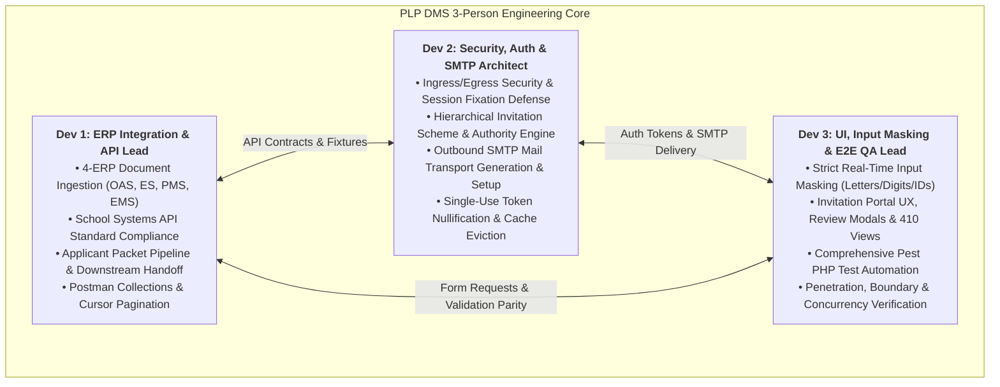
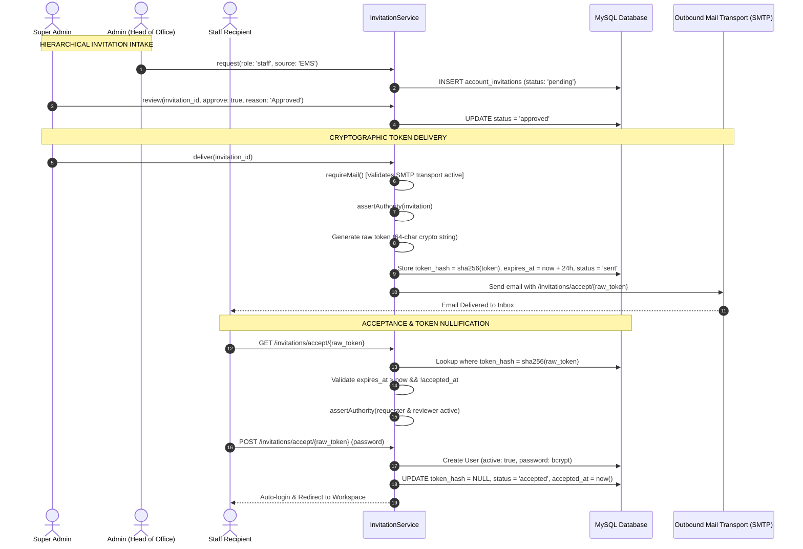
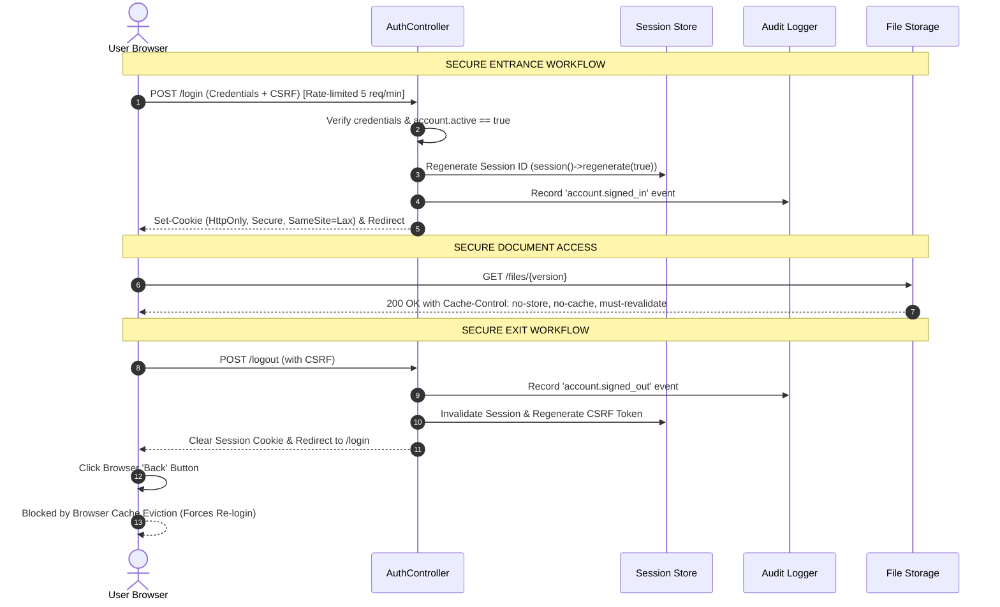
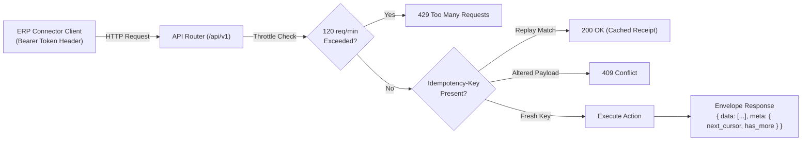

# PLP Document Management System (DMS)

## Final 3-Man Sprint Plan, SMTP Outbound Engine & Execution Blueprint

**Sprint Objective:** Finalize DMS for full institutional deployment across Pamantasan ng Lungsod ng Pasig (PLP). Secure all ingress and egress points, enforce strict field-level input constraints, generate and verify active outbound SMTP mail transport for invitation tokens and password recovery, ingest all document classes across all four connected ERP systems (OAS, ES, PMS, EMS), and execute a comprehensive testing checklist across three consolidated engineering roles.

---

## 1. Team Allocation & Role Responsibilities (3-Person Squad Architecture)

To maximize velocity, cross-functional ownership, and engineering rigor, the team structure is consolidated from a 4-man squad into a high-impact **3-person engineering squad**:



### Detailed Role Allocation Matrix

| Role                                                            | Engineer Specialization             | Core Focus & Sprint Ownership                                                                                                                                                                                                                                                                                                                                                                                                                                                                                                                                                                                                                                                                                                     |
| :-------------------------------------------------------------- | :---------------------------------- | :-------------------------------------------------------------------------------------------------------------------------------------------------------------------------------------------------------------------------------------------------------------------------------------------------------------------------------------------------------------------------------------------------------------------------------------------------------------------------------------------------------------------------------------------------------------------------------------------------------------------------------------------------------------------------------------------------------------------------------- |
| **Dev 1: ERP Integration & API Lead**                           | Lead Backend / Systems Integration  | • Ingestion of all documents across the 4 connected ERPs (OAS, ES, PMS, EMS).<br/>• Strict adherence to [`docs/API-STANDARD.md`](file:///c:/Users/Ivan/Music/sch/docs/API-STANDARD.md): Bearer auth, UUID v4 keys, `data` + `meta` responses (with `next_cursor: null` when `has_more: false`).<br/>• OAS-to-ES applicant packet ingestion and cross-system retrieval without redundant uploads.<br/>• External business history ingestion (`POST /api/v1/history`) with idempotency replay protection.<br/>• Automated Postman test collections and external connector provisioning.                                                                                                                                             |
| **Dev 2: Security, Auth & Outbound Transport (SMTP) Architect** | Lead Security / Auth & Mail Systems | • **SMTP Outbound Mail Transport Generation & Setup** (Mailpit/Mailtrap for staging; Google Workspace / Microsoft 365 / Institutional SMTP for production).<br/>• Hierarchical invitation engine (Super Admin $\rightarrow$ Admin $\rightarrow$ Staff) with token generation and delivery.<br/>• Cryptographic token hashing (`sha256`), dynamic authority verification (`assertAuthority`), and strict single-use nullification (`token_hash = null`).<br/>• Entrance/exit hardening: brute-force login throttling (`throttle:signin`), session fixation defense (`session()->regenerate()`), and 15-minute inactivity timeouts.<br/>• Anti-back-button HTTP cache eviction headers on all authenticated views and file streams. |
| **Dev 3: UI, Input Masking & Quality Assurance (QA) Lead**      | Lead Frontend & Test Automation     | • Strict client-side jQuery masking and server-side Laravel regex validation (letters-only for names, digits-only for revision/numbers, formatted IDs).<br/>• Invitation Portal frontend rebuild: tabbed admin layout, Bootstrap 5.3 modal dialogs for review approval/rejection with required reasons, password set/reset screens, and branded 410 Gone views.<br/>• Execution of full automated test suite using Pest PHP (`php artisan test`) and frontend tests (`npm test`).<br/>• Security penetration checks (SQLi/XSS in masked fields, MIME spoofing bypassing, cross-workspace IDOR).<br/>• Concurrency race-condition testing and 3-person DoD sign-off verification.                                                  |

---

## 2. ERP Document Ingestion & Employee Account Scoping (All 4 Systems)

### 2.1 Architectural Ingestion Model: Zero Database Duplication

The DMS serves as the central, immutable repository for all four PLP enterprise systems. It provides tamper-evident document custody, cryptographic SHA-256 integrity verification, and authorized cross-system retrieval.

> [!IMPORTANT]
> **Employee Account Scoping Rule:**
> DMS does **NOT** duplicate or sync entire HR, payroll, scholastic, or medical database tables from the external ERPs. DMS employee accounts store **strictly**:
>
> 1. Full Legal Name (`name`)
> 2. Institutional Email (`email` ending in `@plp.edu.ph`)
> 3. Assigned Workspace / Source Office (`EMS`, `PMS`, `ES`, `OAS`, or `null` for Super Admin)
> 4. Optional ERP Reference ID on documents (e.g., Student ID `PLP-2026-1011` or Employee Number `EMP-2026-0042`)
>
> All sensitive payroll breakdowns, tax computations, clinic medical records, and course grades remain strictly inside the signed, encrypted PDF binary stored in DMS private storage.

```mermaid
flowchart TD
    subgraph EXTERNAL_ERPS["Connected University Systems"]
        OAS["<b>OAS (Online Admissions)</b><br/>• PSA Birth Cert<br/>• 2x2 Photo<br/>• Form 137/138<br/>• Medical Clearance<br/>• Exam Permit"]
        ES["<b>ES (Enrollment System)</b><br/>• Certificate of Reg (COR)<br/>• Grade Sheets<br/>• Clearance Slips<br/>• Dean Endorsements"]
        PMS["<b>PMS (Payroll Management)</b><br/>• Monthly Payslip PDFs<br/>• BIR Form 2316<br/>• Deduction Mandates<br/>• Payroll Registers"]
        EMS["<b>EMS (Employee Management)</b><br/>• 201 Personnel Dossiers<br/>• Service Records<br/>• Employment Contracts<br/>• Leave Proof Notes"]
    end

    subgraph DMS_CORE["PLP Central DMS Repository"]
        INGEST["<b>Ingress API Gateway (/api/v1)</b><br/>Bearer Auth | Idempotency-Key | MIME Verification"]
        META[("<b>DMS Metadata Store</b><br/>• Title, Subject, Author<br/>• SHA-256 Hash, Byte Size<br/>• Workspace & Classification<br/><i>(Zero redundant HR/Payroll DBs)</i>")]
        VAULT[("<b>Private Vault Storage</b><br/>storage/app/private/{workspace}/{year}/{uuid}.dat<br/>(Completely outside web root)")]
    end

    OAS -->|POST /api/v1/applicant-packets| INGEST
    ES -->|POST /api/v1/documents| INGEST
    PMS -->|POST /api/v1/documents| INGEST
    EMS -->|POST /api/v1/documents| INGEST

    INGEST --> META
    INGEST --> VAULT

    ES -.->|GET /api/v1/applicant-packets/{id}<br/>Stream Admitted Student Files| DMS_CORE
```

### 2.2 Complete Document Inventory Across Connected ERPs

#### A. OAS — Online Admission System

_Source Identifier: `OAS` | Default Classification: `Confidential` (Clinic Records: `Restricted`)_

1. **PSA Birth Certificate:** Proof of citizenship, civil status, and legal name.
2. **2x2 Biometric Photo:** High-resolution applicant headshot for student credentialing.
3. **Parent / Legal Guardian ID:** Government identity card validating parental consent.
4. **Guardianship Affidavit:** Legal notarized affidavit for non-parent guardians.
5. **Form 137 / Grade 11 Form 138:** Certified academic report cards from senior high schools.
6. **Medical Clearance & Clinic Laboratory Results:** Isolated medical evaluations; Super Admin metadata only, Clinic/Physician access only.
7. **Signed Admission Exam Ticket:** Verifiable exam admittance permit with barcode/UUID.
8. **Applicant Packet Bundle (`/api/v1/applicant-packets`):** Atomic intake grouping all applicant files under one applicant ID for zero-reupload downstream handoff to ES upon student admission.

#### B. ES — Enrollment System

_Source Identifier: `ES` | Default Classification: `Confidential`_

1. **Certificate of Registration (COR):** Official term course load, unit assessment, and matriculation record.
2. **Collegiate Grade Sheets & Scholastic Evaluations:** Term-end grades signed by college deans and registrar.
3. **Term Clearance Slips:** Clearance certificates from campus library, student affairs, and accounting.
4. **Admitted Student Packet Transfer:** Ingested reference to OAS-submitted documents without requiring physical resubmission or redundant file uploads.
5. **Cross-Department Endorsement Documents:** Dean special admission, prerequisite waivers, and overload permits.

#### C. PMS — Payroll Management System

_Source Identifier: `PMS` | Default Classification: `Restricted`_

1. **Finalized Monthly Payslip PDFs:** Immutable digital earnings stubs per employee and pay cycle.
2. **Payroll Master Registers & Summaries:** Departmental and university-wide disbursement registers.
3. **BIR Form 2316 (Withholding Tax Certificates):** Annual tax certificates for faculty and personnel.
4. **Loan & Salary Deduction Mandates:** Official GSIS, HDMF (Pag-IBIG), PhilHealth, and bank authorizations.
5. **Payroll Correction & Retroactive Adjustment Reports:** Scoped salary reconciliation records.

#### D. EMS — Employee Management System

_Source Identifier: `EMS` | Default Classification: `Confidential` (Executive files: `Restricted`)_

1. **201 Personnel Record Dossiers:** Complete faculty and administrative appointment dossiers.
2. **Official Service Records:** Complete chronological history of government and collegiate service years.
3. **Employment Contracts & Notices of Appointment:** Official signed Board of Regents resolutions and faculty contracts.
4. **Leave Applications & Medical Attachment Proofs:** Sick leave medical notes, maternity leave proofs, and travel authority clearances.
5. **Faculty Performance Evaluations & Tenure Reviews:** Peer reviews, student evaluations, and Dean assessments.

### 2.3 Storage & Metadata Pipeline

- Files are assigned random UUID v4 names and written to `storage/app/private/{workspace}/{year}/{uuid}.dat` completely outside the web root.
- SHA-256 cryptographic hashes are computed prior to storage to guarantee document integrity.
- Files cannot be accessed directly via static URLs; all access routes enforce Laravel streaming responses (`Storage::download` / `Storage::response`) behind authorization gates.

---

## 3. Hierarchical Invitation Scheme & Token Security Architecture

The DMS invitation scheme implements a multi-tier delegation model with end-to-end token security, authority verification, and strict rate-limiting.



### 3.1 Status Transitions & Security Invariants

| Status     | Triggering Action        | Actor                        | Authority & Rules                                                                                                                                                                                                                             |
| :--------- | :----------------------- | :--------------------------- | :-------------------------------------------------------------------------------------------------------------------------------------------------------------------------------------------------------------------------------------------- |
| `pending`  | `request()`              | Admin (Head of Office)       | Admin may only invite `staff` scoped to their own workspace (`source`).                                                                                                                                                                       |
| `approved` | `review()` / `request()` | Super Admin                  | Super Admin directly invites Admins (`status = approved`). Super Admin approves pending staff invitations with mandatory reason.                                                                                                              |
| `rejected` | `review()`               | Super Admin                  | Super Admin rejects staff invitation with mandatory audit reason (`mb_strlen <= 2000`). Token is never generated.                                                                                                                             |
| `sent`     | `deliver()`              | Super Admin                  | 64-character token generated; SHA-256 hash stored in `token_hash`; expiration set to 24 hours (`1440 min`). Dispatched via SMTP. Resend is throttled by a 60-second cooldown (`429 Too Many Requests`). Old token is invalidated upon resend. |
| `accepted` | `accept()`               | Staff / Admin Recipient      | Recipient sets password. Account activated. **`token_hash` is immediately wiped to `null`** to completely prevent replay attacks.                                                                                                             |
| `revoked`  | `revoke()`               | Super Admin / Inviting Admin | Explicit invalidation. **`token_hash` set to `null`**, `status = revoked`. Visiting token URL returns `410 Gone`.                                                                                                                             |

### 3.2 Dynamic Authority Assertion (`assertAuthority`)

Even after a token is delivered, before allowing password acceptance (`/invitations/accept/{token}`), the system executes real-time authority checks:

1. Verifies the inviting Admin account is still `active = true`, still has `role = admin`, and still possesses access to the assigned workspace.
2. Verifies the approving Super Admin account is still `active = true` and still has `role = super_admin`.
3. If an Admin or Super Admin has been deactivated or transferred between invitation delivery and acceptance, the token is automatically invalidated with HTTP 409 (`Invitation authority has changed.`), preventing rogue account onboarding.

---

## 4. Outbound Mail Transport (SMTP) Generation & Configuration Blueprint

### 4.1 Architectural Requirement & Pre-Flight Enforcement

The invitation system relies on Laravel's mail transport to deliver cryptographically secure invitation links.

In `app/Services/InvitationService.php`, the delivery pipeline executes `requireMail()`:

```php
public function requireMail(): void
{
    $transport = config('mail.mailers.'.config('mail.default').'.transport');
    abort_unless(
        in_array($transport, ['smtp', 'sendmail', 'ses', 'ses-v2', 'postmark', 'resend', 'mailgun']),
        503,
        'Configure an outbound email transport before sending account links.'
    );
}
```

When `MAIL_MAILER=log`, invitation delivery is halted with `503 Service Unavailable` to prevent tokens from being silently discarded in log files without reaching the recipient.

To satisfy this requirement across development, staging, and production environments, Dev 2 is responsible for generating and verifying active SMTP transport credentials as outlined below.

---

### 4.2 Local & Staging SMTP Generation (Mailpit / Mailtrap)

#### Option A: Mailpit (Recommended for Local Dev & Automated Testing)

Mailpit is a lightweight, zero-configuration local SMTP server with an embedded web UI that captures all outbound emails without transmitting them across the public Internet.

1. **Start Mailpit via Docker:**

   ```bash
   docker run -d --name plp-mailpit -p 1025:1025 -p 8025:8025 axllent/mailpit
   ```

   _(Or download the standalone Windows binary `mailpit.exe` and execute `./mailpit.exe`)_

2. **Configure `.env` in the DMS root directory:**

   ```dotenv
   MAIL_MAILER=smtp
   MAIL_SCHEME=null
   MAIL_HOST=127.0.0.1
   MAIL_PORT=1025
   MAIL_USERNAME=null
   MAIL_PASSWORD=null
   MAIL_FROM_ADDRESS="notifications@plp.edu.ph"
   MAIL_FROM_NAME="PLP Document Management System"
   ```

3. **Access Mailbox Web UI:** Open `http://localhost:8025` to inspect invitation emails and click activation links.

#### Option B: Mailtrap Cloud Sandbox (Recommended for QA Staging)

1. Navigate to [Mailtrap.io](https://mailtrap.io) and create a testing inbox named `PLP-DMS-Staging`.
2. Select **Show Credentials** under SMTP Settings.
3. **Configure `.env`:**
   ```dotenv
   MAIL_MAILER=smtp
   MAIL_SCHEME=null
   MAIL_HOST=sandbox.smtp.mailtrap.io
   MAIL_PORT=2525
   MAIL_USERNAME="<your-mailtrap-username>"
   MAIL_PASSWORD="<your-mailtrap-password>"
   MAIL_FROM_ADDRESS="notifications@plp.edu.ph"
   MAIL_FROM_NAME="PLP Document Management System"
   ```

---

### 4.3 Production Institutional SMTP Generation (PLP Google Workspace / Microsoft 365)

For live institutional deployment at Pamantasan ng Lungsod ng Pasig, an official university sender identity must be provisioned.

#### Option 1: Google Workspace (Institutional Gmail SMTP Relay / App Password)

1. **Create Institutional Service Account:** Provision `dms-notifications@plp.edu.ph` in Google Workspace Admin Console.
2. **Enable 2-Step Verification (2SV):** Sign into the account and enable 2SV under Security Settings.
3. **Generate a 16-Character Dedicated App Password:**
   - Navigate to: `myaccount.google.com/apppasswords`
   - Select App: `Mail` | Select Device: `PLP DMS Production Server`
   - Click **Generate**. Copy the 16-character alphanumeric key (e.g., `abcd efgh ijkl mnop`).
4. **Update Production `.env`:**
   ```dotenv
   MAIL_MAILER=smtp
   MAIL_SCHEME=null
   MAIL_HOST=smtp.gmail.com
   MAIL_PORT=587
   MAIL_USERNAME="dms-notifications@plp.edu.ph"
   MAIL_PASSWORD="abcdefghijklmnop"
   MAIL_FROM_ADDRESS="dms-notifications@plp.edu.ph"
   MAIL_FROM_NAME="Pamantasan ng Lungsod ng Pasig - DMS"
   ```
   _(Note: Laravel 13's Symfony Mailer automatically initiates STARTTLS negotiation on port 587)._

#### Option 2: Microsoft 365 / Exchange Online SMTP

1. Enable Authenticated SMTP for the sender mailbox `dms-noreply@plp.edu.ph` in Microsoft 365 Admin Center.
2. **Update Production `.env`:**
   ```dotenv
   MAIL_MAILER=smtp
   MAIL_SCHEME=null
   MAIL_HOST=smtp.office365.com
   MAIL_PORT=587
   MAIL_USERNAME="dms-noreply@plp.edu.ph"
   MAIL_PASSWORD="<Institutional-M365-Secret>"
   MAIL_FROM_ADDRESS="dms-noreply@plp.edu.ph"
   MAIL_FROM_NAME="Pamantasan ng Lungsod ng Pasig - DMS"
   ```

---

### 4.4 Queue Configuration & Background Mail Dispatch

To prevent SMTP network latency from blocking HTTP response cycles during bulk invitation deliveries:

1. Ensure the database queue connection is enabled in `.env`:
   ```dotenv
   QUEUE_CONNECTION=database
   ```
2. Run database migration for jobs table (if not already applied):
   ```bash
   php artisan queue:table
   php artisan migrate
   ```
3. Start the queue worker daemon:
   ```bash
   php artisan queue:work --tries=3 --timeout=90
   ```

---

### 4.5 CLI Verification & SMTP Smoke Test Script

Dev 2 must run this smoke test script via Laravel Tinker to verify live SMTP transport connectivity prior to sprint sign-off:

```bash
php artisan tinker --execute="
    try {
        Illuminate\Support\Facades\Mail::raw('SMTP test delivery from PLP DMS', function (\$message) {
            \$message->to('admin@plp.edu.ph')
                    ->subject('PLP DMS - SMTP Connectivity Smoke Test');
        });
        echo 'SUCCESS: Outbound SMTP email delivered successfully.'.PHP_EOL;
    } catch (\Throwable \$e) {
        echo 'ERROR: SMTP delivery failed: '.\$e->getMessage().PHP_EOL;
    }
"
```

---

## 5. Strict Field-Level Input Validation & Content Masking

All form inputs across DMS enforce strict type constraints. Fields expecting letters strictly reject digits and symbols; fields expecting formatted IDs conform to the university schema.

### 5.1 Field Constraint Specifications

| Form / Field Name                    | Target Input Type      | Allowed Characters & Regex                                                  | Client-Side Masking (jQuery)                                               | Server-Side Validation (Laravel)                                            |
| :----------------------------------- | :--------------------- | :-------------------------------------------------------------------------- | :------------------------------------------------------------------------- | :-------------------------------------------------------------------------- |
| **First / Last / Middle Name**       | Letters Only           | Letters, spaces, apostrophes, dots, hyphens: `^[a-zA-Z\s\.\'-]+$`           | Blocks keypress for `0-9` and symbols; auto-strips invalid chars on paste. | `['required', 'string', 'regex:/^[a-zA-Z\s\.\x27-]+$/', 'max:50']`          |
| **School / Employee / Applicant ID** | Formatted Alphanumeric | Uppercase prefix, year, sequence: `^[A-Z]{2,4}-\d{4}-\d{4,6}$`              | Automatic pattern mask: `AAA-0000-0000` with uppercase conversion.         | `['required', 'string', 'regex:/^[A-Z]{2,4}-\d{4}-\d{4,6}$/']`              |
| **Institutional Email**              | Validated Email        | Valid email format ending strictly in `@plp.edu.ph`                         | Pattern check on blur, block illegal characters.                           | `['required', 'email:rfc,dns', 'regex:/^[a-zA-Z0-9._%+-]+@plp\.edu\.ph$/']` |
| **Document Title**                   | Safe Text              | Letters, numbers, spaces, standard punctuation: `^[a-zA-Z0-9\s\._\-\(\)]+$` | HTML tag stripper (`< >` disallowed); real-time trim.                      | `['required', 'string', 'regex:/^[a-zA-Z0-9\s\._\x2D\(\)]+$/', 'max:200']`  |
| **Subject & Reference Code**         | Alphanumeric & Codes   | Letters, numbers, hyphens, slashes: `^[a-zA-Z0-9\s\/\-_]+$`                 | Real-time rejection of scripts or SQL injection keywords.                  | `['nullable', 'string', 'regex:/^[a-zA-Z0-9\s\/\x2D_]+$/', 'max:100']`      |
| **Revision Number**                  | Positive Integer Only  | Digits `0-9` strictly: `^[1-9][0-9]*$`                                      | Rejects `e`, `+`, `-`, `.`, and non-digit characters.                      | `['required', 'integer', 'min:1', 'max:2147483647']`                        |
| **Salary / Monetary Amount**         | Decimal Currency       | Numbers with up to 2 decimal places: `^\d+(\.\d{1,2})?$`                    | Currency formatting mask with decimal restriction.                         | `['required', 'numeric', 'min:0', 'regex:/^\d+(\.\d{1,2})?$/']`             |
| **Document File Input**              | Whitelisted MIME       | `.pdf`, `.png`, `.jpg`, `.jpeg`, `.csv`, `.docx`, `.xlsx`                   | File input `accept` attribute + extension validator.                       | `['required', 'file', 'mimes:pdf,png,jpg,jpeg,csv,docx,xlsx', 'max:10240']` |
| **Classification Selector**          | Strict Enum            | `Internal`, `Confidential`, `Restricted`                                    | Dropdown choice locking.                                                   | `['required', 'in:Internal,Confidential,Restricted']`                       |

### 5.2 Real-Time Client-Side jQuery Masking Implementation

```javascript
// Strict Letters-Only Mask for Human Names
$(document).on("keypress", ".input-letters-only", function (e) {
  const char = String.fromCharCode(e.which || e.keyCode);
  if (!/^[a-zA-Z\s\.\'-]$/.test(char) && e.which !== 8 && e.which !== 0) {
    e.preventDefault();
    $(this).addClass("is-invalid");
    return false;
  }
  $(this).removeClass("is-invalid");
});

$(document).on("paste input", ".input-letters-only", function () {
  const sanitized = $(this)
    .val()
    .replace(/[^a-zA-Z\s\.\'-]/g, "");
  if (sanitized !== $(this).val()) {
    $(this).val(sanitized);
  }
});

// Strict Digits-Only Mask for Revision and Sequence Numbers
$(document).on("keypress", ".input-digits-only", function (e) {
  const char = String.fromCharCode(e.which || e.keyCode);
  if (!/^[0-9]$/.test(char) && e.which !== 8 && e.which !== 0) {
    e.preventDefault();
    return false;
  }
});

$(document).on("paste input", ".input-digits-only", function () {
  const sanitized = $(this)
    .val()
    .replace(/[^0-9]/g, "");
  if (sanitized !== $(this).val()) {
    $(this).val(sanitized);
  }
});
```

---

## 6. Secure Entrance & Exit Architecture

Entrance and exit mechanisms guarantee that unauthorized individuals cannot enter the system, and departing users leave zero accessible session artifacts, cached documents, or reusable tokens.



### 6.1 Entrance Hardening Controls

1. **Brute-Force Rate Limiting:** `/login` route protected by `throttle:signin` (max 5 failed attempts per IP/username per minute before a 60-second lockout).
2. **Account Status Verification:** Inactive accounts (`active = false`) are rejected at authentication, even with valid credentials.
3. **Session Fixation Prevention:** Session ID is explicitly regenerated with session clearing upon successful credential verification (`$request->session()->regenerate(true)`).
4. **Cookie Security Flags:** Enforced in `config/session.php`: `http_only = true`, `secure = true` (over HTTPS), `same_site = 'lax'`.
5. **Inactivity Timeout:** Automated session termination after 15 minutes of idle time.

### 6.2 Exit Hardening & Anti-Cache Controls

1. **Explicit Invalidation on Logout (`POST /logout`):**
   - Invalidate session data: `$request->session()->invalidate()`.
   - Cycle CSRF token: `$request->session()->regenerateToken()`.
   - Flush authenticated user state and destroy authentication cookies.
2. **Anti-Back-Button Cache Eviction Headers:**
   All authenticated routes, admin dashboards, and file streaming endpoints output strict anti-caching HTTP headers:
   ```http
   Cache-Control: no-store, no-cache, must-revalidate, max-age=0, post-check=0, pre-check=0
   Pragma: no-cache
   Expires: Sat, 01 Jan 2000 00:00:00 GMT
   ```
   When a logged-out user clicks the browser's "Back" button, the browser is forced to revalidate with the server rather than rendering sensitive documents or screens from local memory cache.

---

## 7. Live ERP API Endpoints Contract & Standards

All `/api/v1` routes operate with token-based connector authentication, rate limiting (120 req/min), and strict JSON/Multipart contracts conforming to [`docs/API-STANDARD.md`](file:///c:/Users/Ivan/Music/sch/docs/API-STANDARD.md).



### API Endpoint Registry

| Method | Endpoint                                   | Description & Connected ERP Usage                                                           | Expected HTTP Status                     |
| :----- | :----------------------------------------- | :------------------------------------------------------------------------------------------ | :--------------------------------------- |
| `POST` | `/api/v1/applicant-packets`                | Ingests atomic applicant dossier from **OAS** (birth cert, photo, Form 137/138).            | `201 Created` / `409 Conflict`           |
| `GET`  | `/api/v1/applicant-packets/{id}`           | Retrieves packet metadata and file inventory (consumed by **ES** during enrollment).        | `200 OK` / `404 Not Found`               |
| `GET`  | `/api/v1/applicant-packets/{id}/files/{v}` | Streams clean applicant file bytes to authorized systems (**ES**).                          | `200 OK` (binary stream) / `423 Locked`  |
| `POST` | `/api/v1/documents`                        | Ingests standalone documents from **EMS**, **PMS**, or **ES** with `Idempotency-Key`.       | `201 Created` / `409 Duplicate`          |
| `POST` | `/api/v1/documents/{doc}/versions`         | Ingests subsequent immutable revisions (e.g., corrected payslip or updated service record). | `201 Created` / `409 Conflict`           |
| `GET`  | `/api/v1/documents/{doc}`                  | Retrieves document metadata, classification, and version history.                           | `200 OK` / `404 Not Found`               |
| `GET`  | `/api/v1/files/{ver}`                      | Downloads verified document version payload.                                                | `200 OK` (binary stream) / `404` / `423` |
| `POST` | `/api/v1/history`                          | Ingests business events and external state audits from any of the 4 ERPs.                   | `201 Created` / `200 Replay`             |
| `GET`  | `/api/v1/snapshots/{type}/{record}`        | Retrieves latest recorded external state snapshot for a given ERP record ID.                | `200 OK` / `404 Not Found`               |
| `GET`  | `/api/v1/{resource}`                       | Cursor-paginated feeds for `history`, `events`, `documents`, and `files`.                   | `200 OK` (`data` + `meta`)               |
| `GET`  | `/admin/health`                            | Comprehensive operational, database readiness, and queue health check.                      | `200 OK` (`{"status":"healthy"}`)        |

---

## 8. 5-Day Sprint Execution Timeline (3-Person Squad Plan)

| Day       | Dev 1: ERP Integration & API Lead                                                                                                                        | Dev 2: Security, Auth & SMTP Architect                                                                                                    | Dev 3: UI, Input Masking & E2E QA Lead                                                                                       | Day Milestone                                                                                                 |
| :-------- | :------------------------------------------------------------------------------------------------------------------------------------------------------- | :---------------------------------------------------------------------------------------------------------------------------------------- | :--------------------------------------------------------------------------------------------------------------------------- | :------------------------------------------------------------------------------------------------------------ |
| **Day 1** | Align all `/api/v1` pagination responses to `data` + `meta` (`next_cursor: null` when `has_more: false`). Verify database seeders for OAS, ES, PMS, EMS. | Generate and configure SMTP transport (Mailpit local + Google Workspace production). Test `requireMail()` and `assertAuthority`.          | Implement client-side jQuery masking (`.input-letters-only`, `.input-digits-only`) across all Blade templates.               | Active SMTP transport delivering test emails; API pagination standard compliant; input masking live.          |
| **Day 2** | Implement and test document ingestion across OAS, ES, PMS, and EMS with mandatory `Idempotency-Key` headers.                                             | Harden `/login` rate limiting (`throttle:signin`), session fixation defense (`session()->regenerate(true)`), and anti-cache HTTP headers. | Rebuild invitation management UI with tabs, Bootstrap 5.3 review modals (mandatory reason input), and 410 error screen.      | 4-ERP documents accepted in private storage; login rate-limiting active; invitation UI fully restored.        |
| **Day 3** | Build and test OAS-to-ES applicant packet pipeline (`POST /api/v1/applicant-packets` $\rightarrow$ `GET /api/v1/applicant-packets/{id}`).                | Implement invitation resend 60s cooldown (`429 Too Many Requests`), token SHA-256 generation, and single-use nullification.               | Build password set (`/invitations/accept/{token}`) and reset views adhering to PLP design system; add 4-second toast alerts. | Full end-to-end invitation delivery and acceptance cycle verified; ES consumes OAS packets without re-upload. |
| **Day 4** | Execute full Postman API test collection across all `/api/v1` routes; verify idempotent replays (`200 OK`) and conflicts (`409`).                        | Perform security audit: test browser Back-button cache eviction, token replay attempts, and inactive user ingress blocking.               | Run full Pest PHP automated test suite (`php artisan test`) and frontend test suite (`npm test`). Log all bug fixes.         | Zero test failures in Pest PHP suite; penetration tests pass (SQLi/XSS blocked by masks; tokens single-use).  |
| **Day 5** | Verify operational health check (`GET /admin/health`), API rate limits (120 req/min), and connector revocation.                                          | Run live institutional SMTP smoke test; verify queue worker daemon execution (`php artisan queue:work`).                                  | Conduct cross-browser UI/UX testing; verify responsive layout and print stylesheets; finalize member checklists.             | **Full 3-Man Team Sign-Off achieved.** Production deployment greenlit.                                        |

---

## 9. Member-by-Member Testing & Verification Checklist

### Dev 1: ERP Integration & API Lead Checklist

- [ ] **TC-API-01: Health Endpoint Live Check**
  - Execute `GET /admin/health`. Confirm response is `200 OK` with database, cache, and queue marked `healthy`.
- [ ] **TC-API-02: API Standard Compliance (`data` + `meta`)**
  - Execute `GET /api/v1/documents`. Verify response envelope conforms strictly to `{"data": [...], "meta": {"next_cursor": null, "has_more": false}}`.
- [ ] **TC-API-03: Live `/api/v1/history` Ingestion & Idempotency**
  - Send `POST /api/v1/history` with sample event. Verify `201 Created`.
  - Re-send identical payload with same `event_id`. Verify `200 OK` with `duplicate: true`.
  - Re-send altered payload with same `event_id`. Verify `409 Conflict`.
- [ ] **TC-API-04: OAS Applicant Packet Ingestion**
  - Ingest PSA birth certificate, Form 137, and 2x2 ID photo via `POST /api/v1/applicant-packets`.
  - Verify packet state is persisted with unique UUID and status `submitted`.
- [ ] **TC-API-05: ES Cross-System Packet Retrieval**
  - Using an ES connector Bearer token, execute `GET /api/v1/applicant-packets/{id}`.
  - Verify ES reads and downloads applicant files without requesting re-upload from student.
- [ ] **TC-API-06: PMS Payslip Ingestion & Revisioning**
  - Send finalized payslip PDF via `POST /api/v1/documents` (`classification = Restricted`).
  - Submit revised payslip via `POST /api/v1/documents/{id}/versions` with incremented revision number. Confirm both versions are preserved.
- [ ] **TC-API-07: EMS 201 File & Service Record Ingestion**
  - Upload faculty service record. Verify correct workspace assignment to `EMS`.
- [ ] **TC-API-08: Connector Rate Limiting**
  - Send 125 requests in 60 seconds using a single connector token. Verify request #121 returns `429 Too Many Requests`.

### Dev 2: Security, Auth & SMTP Architect Checklist

- [ ] **TC-SEC-01: SMTP Outbound Mail Transport Verification**
  - Run `php artisan tinker` smoke test script. Confirm email arrives in mailbox/Mailpit with valid headers.
  - Verify `InvitationService::requireMail()` passes without throwing HTTP 503.
- [ ] **TC-SEC-02: Hierarchical Invitation Flow & Delivery**
  - Request invitation as Admin (`status = pending`).
  - Review and approve as Super Admin with reason (`status = approved`).
  - Deliver invitation (`deliver()`). Verify email sent, status changed to `sent`, and raw token generated.
- [ ] **TC-SEC-03: Invitation 60-Second Cooldown & Token Replacement**
  - Attempt immediate resend within 60 seconds. Verify HTTP 429 (`Please wait before resending`).
  - Resend after 60 seconds. Verify old token is invalidated and fresh token hash is stored.
- [ ] **TC-SEC-04: Single-Use Token Nullification on Acceptance**
  - Open `/invitations/accept/{token}` and set password.
  - Verify account is created (`active = true`), user logged in, and database record has `token_hash = null`.
  - Refresh or re-enter the acceptance URL. Confirm server returns `410 Gone`.
- [ ] **TC-SEC-05: Dynamic Authority Assertion (`assertAuthority`)**
  - Deliver invitation for staff under Admin A. Deactivate Admin A.
  - Attempt to accept the invitation. Confirm server aborts with HTTP 409 (`Invitation authority has changed.`).
- [ ] **TC-SEC-06: Entrance Brute-Force Rate Limiting**
  - Attempt 6 consecutive failed logins on `/login` with invalid credentials.
  - Confirm HTTP 429 response or locked notification on the 6th attempt.
- [ ] **TC-SEC-07: Session Fixation Defense**
  - Record session cookie value before login.
  - Successfully log in and verify session cookie value has changed completely.
- [ ] **TC-SEC-08: Anti-Back-Button Cache Eviction**
  - Open and preview a `Confidential` document in browser. Click Logout (`POST /logout`).
  - Press browser "Back" button. Confirm browser displays login screen or blank error rather than cached document preview.
  - Inspect response headers for `Cache-Control: no-store, no-cache, must-revalidate`.

### Dev 3: UI, Input Masking & E2E QA Lead Checklist

- [ ] **TC-UI-01: Letters-Only Field Enforcement (Live Keypress)**
  - In user profile / author fields, attempt typing numbers (`0-9`) or symbols (`@#$%^&*`).
  - Verify characters are blocked immediately on keypress and do not appear in the input box.
- [ ] **TC-UI-02: Letters-Only Field Enforcement (Clipboard Paste)**
  - Copy `Juan Dela Cruz 1234!@#` and paste into First Name field.
  - Verify field immediately strips invalid characters, displaying only `Juan Dela Cruz`.
- [ ] **TC-UI-03: Digits-Only Field Enforcement**
  - In Revision Number and Phone Number fields, attempt typing alphabetic letters (`a-z`, `A-Z`).
  - Verify keypresses are ignored and input only accepts numerical values `0-9`.
- [ ] **TC-UI-04: Formatted ID Input Masking**
  - Enter student/applicant ID field. Type `plp202612345`.
  - Confirm UI auto-formats to uppercase standard: `PLP-2026-12345`.
- [ ] **TC-UI-05: Document Title Sanitization**
  - Enter document title `<script>alert('xss')</script> Semester Report`.
  - Verify UI sanitizes script tags, and server validation rejects invalid characters.
- [ ] **TC-UI-06: Strict Institutional Email Validation**
  - Enter `student@gmail.com` into user email field.
  - Confirm field displays red `is-invalid` validation border and notification indicating `@plp.edu.ph` requirement.
- [ ] **TC-UI-07: Four-Second Toast Feedback & Progress Bar**
  - Submit valid form. Confirm top-right notification toast displays for exactly 4,000ms with smooth jQuery UI countdown progress bar before dismissal.
- [ ] **TC-QA-01: Full Automated Test Suite Execution (Pest PHP)**
  - Run `php artisan test`. Verify all 184+ feature and unit tests pass with 0 failures.
- [ ] **TC-QA-02: Frontend Unit Tests**
  - Run `npm test`. Verify all 25 frontend tests pass with 0 failures.
- [ ] **TC-QA-03: Server-Side Form Request Bypass Test**
  - Bypass frontend UI using curl/Postman to send numeric strings to letters-only server endpoints: `POST /admin/accounts` with `name: "John123"`.
  - Confirm server returns `422 Unprocessable Content` with validation error for `name`.
- [ ] **TC-QA-04: MIME Spoofing Penetration Test**
  - Rename an executable `malicious.exe` to `annual_report.pdf` and attempt upload.
  - Confirm server binary magic-byte inspection (`finfo`) rejects the file with invalid MIME type error.
- [ ] **TC-QA-05: Concurrency & Duplicate Race Conditions**
  - Concurrently upload identical document bytes from two separate threads using identical `Idempotency-Key`.
  - Confirm exactly one document record is created and second thread receives `200 OK` (replay).
- [ ] **TC-QA-06: Cross-Workspace IDOR Isolation**
  - Authenticate as Staff in `EMS`. Attempt `GET /documents/{restricted_doc_id}` belonging to `PMS`.
  - Confirm server returns `404 Not Found` (never exposing document existence or metadata).

---

## 10. Definition of Done (DoD) for 3-Man Team Sign-Off

Before the final sprint is closed and the release candidate is deployed, all three engineers must formally sign off on the following criteria:

1. **4-ERP Integration Complete:** OAS, ES, PMS, and EMS document categories are completely represented in the workspace registry and can be ingested/retrieved cleanly via `/api/v1` routes.
2. **Outbound SMTP Active & Verified:** Active outbound SMTP transport is generated, configured in `.env`, verified via Tinker smoke test, and successfully delivers invitation tokens.
3. **Hierarchical Invitation Security:** Pending $\rightarrow$ Approved $\rightarrow$ Sent $\rightarrow$ Accepted lifecycle operates with 60s cooldowns, dynamic authority validation (`assertAuthority`), and single-use token hash nullification (`token_hash = null`).
4. **Strict Field Whitelisting:** Every form field strictly accepts only its declared data format (letters only, numbers only, formatted codes) on both client (jQuery) and server (Laravel regex).
5. **Ingress/Egress Hardening:** Rate limiting (5 req/min), session fixation regeneration, anti-back-button cache eviction headers, and 15-minute inactivity timeouts are 100% active.
6. **Zero Regression:** All automated Pest PHP tests (`php artisan test`) and frontend tests (`npm test`) pass with 0 errors and 0 failures.
