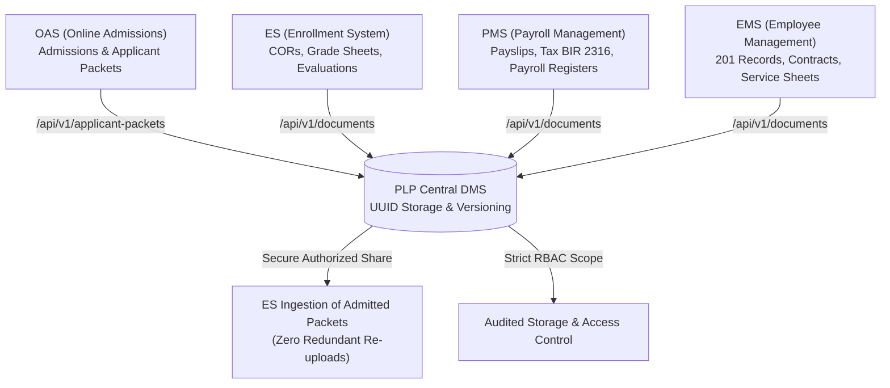
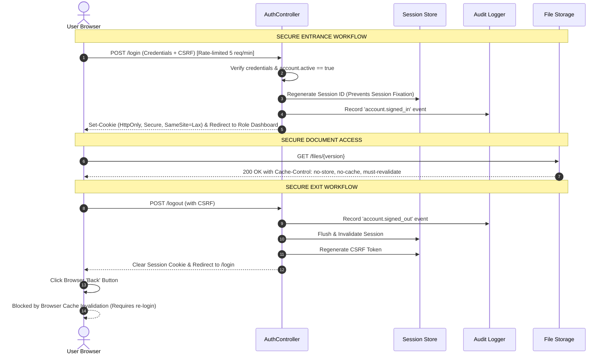
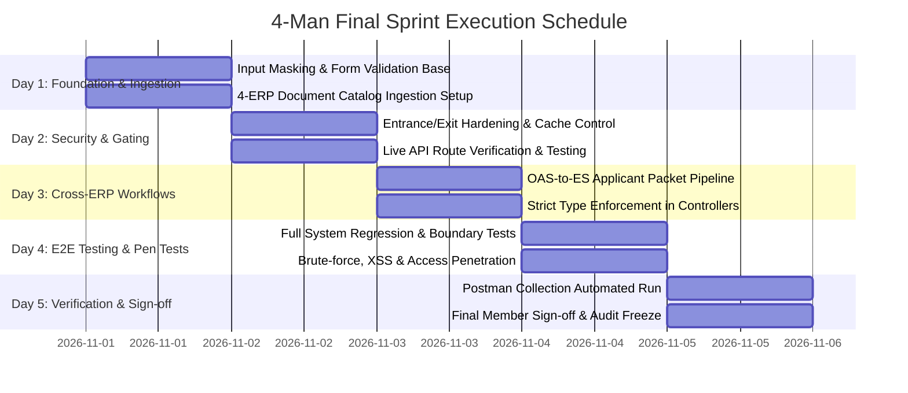

# PLP Document Management System (DMS)

## Final 4-Man Sprint Plan & Execution Blueprint

**Sprint Objective:** Finalize DMS for full institutional deployment across Pamantasan ng Lungsod ng Pasig. Secure all ingress/egress points, enforce strict field-level input constraints, verify live ERP API contracts, ingest all document classes from four connected ERP systems, and execute a comprehensive testing checklist across four dedicated engineering roles.

---

## 1. Team Allocation & Role Responsibilities (4-Man Squad)

| Role                                     | Engineer                   | Core Focus & Sprint Ownership                                                                                                                             |
| :--------------------------------------- | :------------------------- | :-------------------------------------------------------------------------------------------------------------------------------------------------------- |
| **Dev 1: ERP Integration & API Lead**    | Lead Backend / Integration | Ingestion of all documents from the 4 ERPs (OAS, ES, PMS, EMS), live `/api/v1` route verification, applicant packet pipeline, and Postman test contracts. |
| **Dev 2: Security & Session Architect**  | Security / Backend         | Entrance/exit hardening, brute-force throttling, session lifecycle, token invalidation, no-cache headers, RBAC matrices, and data classification.         |
| **Dev 3: UI & Strict Input Masking Dev** | Frontend / Blade / jQuery  | Complete input box sanitization and real-time masking (letters-only, numbers-only, regex validation), form UX, error toasts, and visual feedback.         |
| **Dev 4: QA, Concurrency & E2E Tester**  | Test Automation / QA       | Comprehensive test execution, regression suites, penetration checks (XSS/SQLi/IDOR/tampering), concurrency testing, and member sign-off verification.     |

---

## 2. ERP Document & File Ingestion Strategy (All 4 Systems)

The DMS serves as the central, immutable repository for all four PLP enterprise systems. Each system retains operational record ownership, while DMS provides tamper-evident document custody, revision tracking, and authorized cross-system retrieval.



### 2.1 Complete Document Inventory Across Connected ERPs

#### A. OAS — Online Admission System

_Source Identifier: `OAS` | Default Classification: `Confidential` (Clinic files: `Restricted`)_

1. **PSA Birth Certificate:** Proof of citizenship and legal name.
2. **2x2 Applicant Photo:** High-resolution biometric headshot for student identification.
3. **Parent / Guardian Government-Issued ID:** Identity validation for underage applicants.
4. **Guardianship Affidavit & Legal Documents:** For non-parent legal guardians.
5. **Form 137 / Grade 11 Form 138:** Academic transcripts from senior high schools.
6. **Medical Clearance & Clinic Laboratory Results:** Strictly isolated Clinic health assessments; Super Admin metadata only, Clinic/Physician access only.
7. **Signed Examination Permit / Ticket:** Verified admission exam admittance slip.
8. **Applicant Packet Bundle (`/api/v1/applicant-packets`):** Atomic intake grouping all the above files under a unified applicant ID for instant downstream handoff to ES upon student admission.

#### B. ES — Enrollment System

_Source Identifier: `ES` | Default Classification: `Confidential`_

1. **Certificate of Registration (COR):** Official term course load and enrollment certification.
2. **Official Grade Sheets & Evaluation Forms:** Term-end collegiate grades and scholastic standing.
3. **Enrollment Clearance Slips:** Clearance from library, student affairs, and college departments.
4. **Admitted Student Packet Transfer:** Ingested reference to OAS-submitted documents without requiring physical resubmission or redundant file uploads.
5. **Cross-Department Endorsement Documents:** Dean / Registrar special admission permits.

#### C. PMS — Payroll Management System

_Source Identifier: `PMS` | Default Classification: `Restricted`_

1. **Finalized Monthly Payslip PDFs:** Immutable digital earnings stubs per employee and pay cycle.
2. **Payroll Master Registers & Summaries:** Departmental and campus-wide payroll disbursement records.
3. **BIR Form 2316 (Tax Certificates):** Annual withholding tax certificates for faculty and personnel.
4. **Loan & Salary Deduction Authorizations:** Official bank, GSIS, HDMF/Pag-IBIG, and PhilHealth mandates.
5. **Payroll Correction & Retroactive Adjustment Reports:** Scoped salary reconciliation records.

#### D. EMS — Employee Management System

_Source Identifier: `EMS` | Default Classification: `Confidential` (Executive files: `Restricted`)_

1. **201 Personnel Record Dossiers:** Complete faculty and administrative appointment dossiers.
2. **Official Service Records:** Complete history of government and university service years.
3. **Employment Contracts & Notices of Appointment:** Official signed Board of Regents resolutions and contracts.
4. **Leave Applications & Medical Attachment Proofs:** Sick leave medical notes and vacation clearances.
5. **Faculty Performance Evaluations & Tenure Reviews:** Peer reviews, student evaluations, and Dean assessments.

### 2.2 Storage & Metadata Pipeline

- Files are assigned random UUID v4 names and written to `storage/app/private/{workspace}/{year}/{uuid}.dat` completely outside the web root.
- SHA-256 cryptographic hashes are computed prior to storage to guarantee document integrity.
- Files cannot be accessed directly via static URLs; all access routes enforce Laravel streaming responses (`Storage::download` / `Storage::response`) behind authorization gates.

---

## 3. Security Hardening Blueprint

> [!IMPORTANT]
> Security is enforced at every layer of the DMS architecture. Server-side authorization gates, cryptographic integrity checks, strict session governance, and tamper-evident audit logging operate concurrently.

### 3.1 Role-Based Access Control (RBAC) & Data Classification

- **Three Core Roles:**
  - `super_admin`: Campus-wide oversight (`source = null`), account governance, connector provisioning, and exclusive management of `Restricted` document sharing.
  - `admin`: Scoped strictly to assigned workspace (`EMS`, `PMS`, `ES`, `OAS`). Manages staff accounts, folders, and `Internal`/`Confidential` files.
  - `staff`: Scoped strictly to personal submissions and documents explicitly shared via `Viewer`, `Commenter`, or `Editor` grants.
- **Classification Visibility Matrix:**
  - `Internal`: Visible to all active accounts within the workspace + Super Admin.
  - `Confidential`: Visible only to Owner, Source Admin, Super Admin, and explicit share recipients.
  - `Restricted`: Visible **only** to Owner, Super Admin, and explicit recipients. Source Admins have zero visibility unless granted. Unauthorized queries return **404 Not Found** (preventing resource enumeration).

### 3.2 File Integrity & Anti-Spoofing Protections

- **MIME Sniffing Prevention:** Server reads the file's binary magic bytes (`finfo`) rather than trusting the user-supplied extension.
- **Path Traversal Shield:** Filenames are stripped of `../`, `..\\`, null bytes, and non-ASCII path characters.
- **Replay Protection:** API uploads enforce mandatory `Idempotency-Key` headers (1–100 chars). Replays return the original receipt; payload changes with an existing key return `409 Conflict`.
- **Integrity Validation:** If a stored file's on-disk SHA-256 hash does not match its database hash, access is immediately blocked with HTTP 409.

### 3.3 HTTP Security Headers & Cross-Site Defenses

- `X-Frame-Options: DENY` (prevents clickjacking attacks).
- `X-Content-Type-Options: nosniff` (prevents MIME type confusion attacks).
- `Content-Security-Policy: default-src 'self'; script-src 'self' 'unsafe-inline'; style-src 'self' 'unsafe-inline'; img-src 'self' data: blob:; object-src 'self' blob:;`
- CSRF Protection: Enforced via `X-CSRF-TOKEN` on all web `POST`, `PUT`, `PATCH`, `DELETE` requests.

---

## 4. Strict Field-Level Input Validation & Content Masking

All form fields across DMS must enforce strict type constraints. If a field expects letters only, it must strictly reject numeric digits and symbols. If a field expects formatted IDs, it must conform to the university schema.

### 4.1 Field Constraint Specifications

| Form / Field Name                        | Target Input Type      | Allowed Characters & Regex                                                  | Client-Side Masking (jQuery)                                       | Server-Side Validation (Laravel)                                            |
| :--------------------------------------- | :--------------------- | :-------------------------------------------------------------------------- | :----------------------------------------------------------------- | :-------------------------------------------------------------------------- |
| **First Name / Last Name / Middle Name** | Letters Only           | Letters, spaces, apostrophes, dots, hyphens: `^[a-zA-Z\s\.\'-]+$`           | Block keypress for `0-9` and symbols; auto-strip on paste.         | `['required', 'string', 'regex:/^[a-zA-Z\s\.\x27-]+$/', 'max:50']`          |
| **School / Employee / Applicant ID**     | Formatted Alphanumeric | Uppercase prefix, year, digits: `^[A-Z]{2,4}-\d{4}-\d{4,6}$`                | Automatic pattern mask: `AAA-0000-0000` with uppercase conversion. | `['required', 'string', 'regex:/^[A-Z]{2,4}-\d{4}-\d{4,6}$/']`              |
| **Institutional Email**                  | Validated Email        | Valid email format ending in `@plp.edu.ph`                                  | Pattern check on blur, block illegal characters.                   | `['required', 'email:rfc,dns', 'regex:/^[a-zA-Z0-9._%+-]+@plp\.edu\.ph$/']` |
| **Document Title**                       | Safe Text              | Letters, numbers, spaces, standard punctuation: `^[a-zA-Z0-9\s\._\-\(\)]+$` | HTML tag stripper (`< >` disallowed); real-time trim.              | `['required', 'string', 'regex:/^[a-zA-Z0-9\s\._\x2D\(\)]+$/', 'max:200']`  |
| **Subject & Reference Code**             | Alphanumeric & Codes   | Letters, numbers, hyphens, slashes: `^[a-zA-Z0-9\s\/\-_]+$`                 | Real-time rejection of scripts or SQL keywords.                    | `['nullable', 'string', 'regex:/^[a-zA-Z0-9\s\/\x2D_]+$/', 'max:100']`      |
| **Revision Number**                      | Positive Integer Only  | Digits `0-9` strictly: `^[1-9][0-9]*$`                                      | Rejects `e`, `+`, `-`, `.`, and non-digit characters.              | `['required', 'integer', 'min:1', 'max:2147483647']`                        |
| **Salary / Numeric Amounts**             | Decimal Currency       | Numbers with up to 2 decimal places: `^\d+(\.\d{1,2})?$`                    | Currency formatting mask with decimal restriction.                 | `['required', 'numeric', 'min:0', 'regex:/^\d+(\.\d{1,2})?$/']`             |
| **Document File Input**                  | Whitelisted MIME       | `.pdf`, `.png`, `.jpg`, `.jpeg`, `.csv`, `.docx`, `.xlsx`                   | File input `accept` attribute + extension validator.               | `['required', 'file', 'mimes:pdf,png,jpg,jpeg,csv,docx,xlsx', 'max:10240']` |
| **Classification Selector**              | Strict Enum            | `Internal`, `Confidential`, `Restricted`                                    | Dropdown choice locking.                                           | `['required', 'in:Internal,Confidential,Restricted']`                       |

### 4.2 Frontend jQuery Input Masking Implementation Template

```javascript
// Strict Letters-Only Mask for Name Inputs
$(document).on("keypress", ".input-letters-only", function (e) {
  const char = String.fromCharCode(e.which || e.keyCode);
  if (!/^[a-zA-Z\s\.\'-]$/.test(char) && e.which !== 8 && e.which !== 0) {
    e.preventDefault();
    $(this).addClass("is-invalid");
    return false;
  }
  $(this).removeClass("is-invalid");
});

$(document).on("paste input", ".input-letters-only", function () {
  const sanitized = $(this)
    .val()
    .replace(/[^a-zA-Z\s\.\'-]/g, "");
  if (sanitized !== $(this).val()) {
    $(this).val(sanitized);
  }
});

// Strict Digits-Only Mask for Numerical Quantities
$(document).on("keypress", ".input-digits-only", function (e) {
  const char = String.fromCharCode(e.which || e.keyCode);
  if (!/^[0-9]$/.test(char) && e.which !== 8 && e.which !== 0) {
    e.preventDefault();
    return false;
  }
});
```

---

## 5. Secure Entrance & Exit Architecture

Entrance and exit mechanisms guarantee that unauthorized individuals cannot enter the system, and that departing users leave no accessible session artifacts, cached documents, or reusable tokens.



### 5.1 Entrance Security Controls

1. **Brute-Force Rate Limiting:** `/login` route protected by `throttle:signin` (max 5 failed attempts per IP/username per minute before 60-second lockout).
2. **Account Status Gate:** Inactive or unapproved accounts (`active = false`) are rejected at authentication, even with valid passwords.
3. **Session Fixation Prevention:** Session ID is explicitly regenerated upon successful credential verification (`$request->session()->regenerate()`).
4. **Cookie Flags:** `session.php` enforced settings: `http_only = true`, `secure = true` (over HTTPS), `same_site = 'lax'`.
5. **Invitation Account Activation:** Single-use cryptographic tokens (SHA-256) expiring after 48 hours for staff onboarding.

### 5.2 Exit Security & Anti-Cache Controls

1. **Explicit Invalidation on Logout (`POST /logout`):**
   - Invalidate session data store: `$request->session()->invalidate()`.
   - Cycle CSRF token: `$request->session()->regenerateToken()`.
   - Flush authenticated user state and destroy authentication cookies.
2. **Anti-Back-Button Cache Invalidation:**
   - All authenticated routes and file preview/download endpoints output strict no-cache HTTP headers:
     ```http
     Cache-Control: no-store, no-cache, must-revalidate, max-age=0, post-check=0, pre-check=0
     Pragma: no-cache
     Expires: Sat, 01 Jan 2000 00:00:00 GMT
     ```
   - When a user logs out and clicks the browser's "Back" button, the browser is forced to revalidate with the server rather than serving cached document previews or sensitive dashboards from local memory.
3. **Session Inactivity Timeout:** Automated session termination after 15 minutes of idle time.
4. **Immediate API Revocation:** Super Admin connector revocation instantaneously invalidates connector Bearer tokens.

---

## 6. Live ERP API Endpoints Contract & Status

All `/api/v1` routes operate with token-based connector authentication, rate limiting (120 req/min), and strict JSON/Multipart contracts.

| Method | Endpoint                                         | Description & Connected ERP Usage                                                             | Expected HTTP Status                     |
| :----- | :----------------------------------------------- | :-------------------------------------------------------------------------------------------- | :--------------------------------------- |
| `POST` | `/api/v1/applicant-packets`                      | Ingests atomic applicant dossier from **OAS** (includes birth cert, photos, Form 137/138).    | `201 Created` / `409 Conflict`           |
| `GET`  | `/api/v1/applicant-packets/{packet}`             | Retrieves packet metadata and file inventory (used by **ES** during student enrollment).      | `200 OK` / `404 Not Found`               |
| `GET`  | `/api/v1/applicant-packets/{packet}/files/{ver}` | Streams clean, verified applicant file bytes to authorized systems (**ES**).                  | `200 OK` (binary stream) / `423 Locked`  |
| `POST` | `/api/v1/documents`                              | Ingests standalone documents from **EMS**, **PMS**, or **ES** with `Idempotency-Key`.         | `201 Created` / `409 Duplicate`          |
| `POST` | `/api/v1/documents/{doc}/versions`               | Ingests subsequent immutable revisions (e.g., corrected payslips or updated service records). | `201 Created` / `409 Conflict`           |
| `GET`  | `/api/v1/documents/{doc}`                        | Retrieves document metadata, classification, and version lists.                               | `200 OK` / `404 Not Found`               |
| `GET`  | `/api/v1/files/{ver}`                            | Downloads verified document version payload.                                                  | `200 OK` (binary stream) / `404` / `423` |
| `POST` | `/api/v1/history`                                | Ingests business events and external state audits from any of the 4 ERPs.                     | `201 Created` / `200 Replay`             |
| `GET`  | `/api/v1/snapshots/{type}/{record}`              | Retrieves latest recorded external state snapshot for a given ERP record ID.                  | `200 OK` / `404 Not Found`               |
| `GET`  | `/api/v1/{resource}`                             | Cursor-paginated feeds for `history`, `events`, `documents`, and `files`.                     | `200 OK`                                 |
| `GET`  | `/admin/health`                                  | Comprehensive operational and database readiness health check.                                | `200 OK` (`{"status":"healthy"}`)        |

---

## 7. Sprint Execution Timeline (5-Day Goal Plan)



### Day 1: Catalog Schema, Input Masking & API Baseline

- **Goal:** Establish strict input masking on all Blade templates; verify database schema supports all 4 ERP document types; execute initial API health checks.
- **Milestone:** All form inputs visually and programmatically enforce letter-only or number-only restrictions.

### Day 2: ERP Document Ingestion & Storage Security Hardening

- **Goal:** Ingest test documents across OAS, ES, PMS, and EMS; enforce SHA-256 integrity and MIME verification; harden entrance and exit routes.
- **Milestone:** All 4 ERP workspace folders accept respective document types; unauthorized direct downloads return 404/403.

### Day 3: Cross-System Handover & Live API Verification

- **Goal:** Complete the OAS-to-ES applicant packet pipeline; execute Postman API suite against live `/api/v1` endpoints; verify idempotency replays.
- **Milestone:** ES successfully reads an OAS applicant packet without re-uploading files; zero contract mismatches on `/api/v1`.

### Day 4: Comprehensive QA, Penetration & Boundary Testing

- **Goal:** Dev 4 executes full test matrix across roles; test input boundary conditions (SQLi payloads in letters-only fields, oversized files, tampered headers).
- **Milestone:** Zero critical security or validation defects; defect burndown logged in QA tracker.

### Day 5: Final Dry-Run, Performance Stress & Institutional Sign-Off

- **Goal:** Execute live concurrency test under simulated load; verify browser Back-button cache eviction after logout; finalize audit reports.
- **Milestone:** Complete 4-man sprint sign-off; release ready for production evaluation.

---

## 8. Member-by-Member Testing & Verification Checklist

### Dev 1: ERP Integration & API Lead Checklist

- [ ] **TC-API-01: Health Endpoint Live Check**
  - Make `GET /admin/health` request. Confirm response is `200 OK` with all database and queue statuses marked healthy.
- [ ] **TC-API-02: Live `/api/v1/history` Ingestion & Idempotency**
  - Send `POST /api/v1/history` with sample event. Verify `201 Created`.
  - Re-send identical payload with same `event_id`. Verify `200 OK` with `duplicate: true`.
  - Re-send with altered payload but same `event_id`. Verify `409 Conflict`.
- [ ] **TC-API-03: OAS Ingestion & Packet Assembly**
  - Ingest PSA birth certificate, Form 137, 2x2 ID photo via `POST /api/v1/applicant-packets`.
  - Verify packet state is persisted with unique UUID and status `submitted`.
- [ ] **TC-API-04: ES Cross-System Packet Retrieval**
  - Using an ES connector token, execute `GET /api/v1/applicant-packets/{packet_id}`.
  - Verify ES can view and download files without requesting re-upload from student.
- [ ] **TC-API-05: PMS Payslip Ingestion & Revisioning**
  - Send finalized payslip PDF via `POST /api/v1/documents` (`classification = Restricted`).
  - Submit revised payslip via `POST /api/v1/documents/{id}/versions` with incremented revision number. Confirm both versions are preserved.
- [ ] **TC-API-06: EMS 201 File & Service Record Ingestion**
  - Upload faculty service record. Verify correct workspace assignment to `EMS`.
- [ ] **TC-API-07: Rate Limiting Verification**
  - Send 125 requests in 60 seconds with single connector token. Verify request #121 returns `429 Too Many Requests`.

### Dev 2: Security & Session Architect Checklist

- [ ] **TC-SEC-01: Entrance Brute-Force Rate Limiting**
  - Attempt 6 consecutive failed logins on `/login` with incorrect credentials.
  - Confirm HTTP 429 response or locked notification on the 6th attempt.
- [ ] **TC-SEC-02: Session Fixation Defense**
  - Record session cookie value before login.
  - Successfully log in and verify session cookie value has changed completely.
- [ ] **TC-SEC-03: Complete Session Invalidation on Logout**
  - Log in as Admin. Navigate to `/workspaces/EMS`.
  - Click Logout (`POST /logout`). Verify redirection to `/login`.
  - Re-request `/workspaces/EMS` using previous session ID. Confirm immediate redirect to `/login`.
- [ ] **TC-SEC-04: Anti-Back-Button Cache Test**
  - Open and preview a `Confidential` document in browser.
  - Click Logout.
  - Press browser "Back" button. Confirm browser displays login screen or blank error rather than cached document preview.
  - Inspect HTTP response headers for `Cache-Control: no-store, no-cache, must-revalidate`.
- [ ] **TC-SEC-05: Data Classification Server-Side Isolation**
  - Authenticate as Staff (User A) in `EMS`.
  - Attempt direct request `GET /documents/{restricted_doc_id}` belonging to `PMS`.
  - Confirm server returns `404 Not Found` (never exposing document existence or metadata).
- [ ] **TC-SEC-06: Tamper-Evident Audit Logging**
  - Perform document download, share grant, and document trashing.
  - Query audit table (`Access::audit`). Verify user ID, IP address, timestamp, and action are accurately recorded.

### Dev 3: UI & Strict Input Masking Specialist Checklist

- [ ] **TC-UI-01: Letters-Only Field Enforcement (Live Keypress)**
  - In user profile / document author fields, attempt typing numbers (`0-9`) or symbols (`@#$%^&*`).
  - Verify characters are blocked immediately on keypress and do not appear in the input box.
- [ ] **TC-UI-02: Letters-Only Field Enforcement (Clipboard Paste)**
  - Copy `Juan Dela Cruz 1234!@#` and paste into First Name field.
  - Verify field immediately strips invalid characters, displaying only `Juan Dela Cruz`.
- [ ] **TC-UI-03: Digits-Only Field Enforcement**
  - In Revision Number and Phone Number fields, attempt typing alphabetic letters (`a-z`, `A-Z`).
  - Verify keypresses are ignored and input only accepts numerical values `0-9`.
- [ ] **TC-UI-04: Formatted ID Input Masking**
  - Enter student/applicant ID field. Type `plp202612345`.
  - Confirm UI auto-formats to uppercase standard: `PLP-2026-12345`.
- [ ] **TC-UI-05: Document Title Sanitization**
  - Enter document title `<script>alert('xss')</script> Semester Report`.
  - Verify UI sanitizes or blocks script tags, and server validation rejects invalid tag characters.
- [ ] **TC-UI-06: Strict Institutional Email Validation**
  - Enter `student@gmail.com` into user email field.
  - Confirm field displays red `is-invalid` validation border and notification indicating `@plp.edu.ph` requirement.
- [ ] **TC-UI-07: Four-Second Toast Feedback & Progress Bar**
  - Submit valid form. Confirm top-right notification toast displays for exactly 4,000ms with smooth jQuery UI countdown progress bar before dismiss.

### Dev 4: QA, Concurrency & E2E Tester Checklist

- [ ] **TC-QA-01: End-to-End Cross-System Workflow**
  - Step 1: Simulate OAS uploading complete applicant packet via API.
  - Step 2: Super Admin verifies intake in OAS workspace.
  - Step 3: ES queries packet by applicant ID via API and downloads PSA birth cert.
  - Step 4: Verify complete chain in audit log with zero data duplication.
- [ ] **TC-QA-02: Server-Side Form Request Bypass Test**
  - Bypass frontend UI using curl/Postman to send numeric strings to letters-only server endpoints:
    `POST /admin/accounts` with `name: "John123"`.
  - Confirm server returns `422 Unprocessable Content` with validation error for `name`.
- [ ] **TC-QA-03: MIME Spoofing Penetration Test**
  - Rename an executable `malicious.exe` to `annual_report.pdf` and attempt upload.
  - Confirm server MIME detection rejects the file with invalid MIME type error.
- [ ] **TC-QA-04: Concurrency & Duplicate Race Conditions**
  - Concurrently upload the exact same document bytes from two separate threads using identical `Idempotency-Key`.
  - Confirm exactly one document record is created and second thread receives `200 OK` (replay) or advisory duplicate warning.
- [ ] **TC-QA-05: Inactive Account Ingress Block**
  - In database/admin panel, toggle user account `active = false`.
  - Attempt login with correct password. Confirm login is blocked with invalid/inactive error.
  - If user was already logged in, verify subsequent request terminates session and redirects to `/login`.
- [ ] **TC-QA-06: Complete Automated Test Suite Execution**
  - Run test suite: `php artisan test`.
  - Verify all feature tests, unit tests, and scope verification tests pass with 0 failures.

---

## 9. Definition of Done (DoD) for Sprint Sign-Off

Before the final sprint is closed, all four engineers must sign off on the following criteria:

1. **4 ERP Integration:** OAS, ES, PMS, and EMS document categories are completely represented in the workspace registry and can be ingested/retrieved cleanly.
2. **Security Integrity:** Zero unauthorized data access across `Internal`, `Confidential`, and `Restricted` tiers; all direct file downloads require authenticated session authorization.
3. **Field Content Whitelisting:** Every single input field strictly accepts only its declared data format (letters only, numbers only, formatted codes) on both client and server.
4. **Ingress/Egress Lockdown:** Login rate limiting, session regeneration, secure logout teardown, and anti-cache headers are 100% active and verified in browser history tests.
5. **API Operational Health:** All `/api/v1` routes and `/admin/health` return live, valid responses matching the DMS API specification.
6. **Zero Regression:** All automated PHPUnit and frontend unit tests pass without errors.
